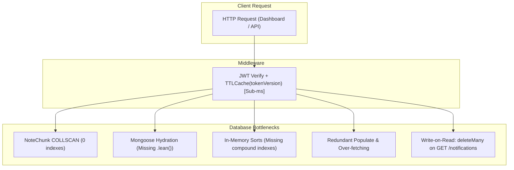

# Performance Bottleneck Analysis: StudentAI Backend

**Author**: Senior Backend Performance Engineer  
**Date**: November 2026  
**Status**: Preliminary Audit (Pre-Optimization)

---

## 1. Summary of Identified Bottlenecks

Through static code analysis, query path tracing, and schema inspection of all 20 route modules and Mongoose models, we identified critical architectural and database-level bottlenecks across the primary student workflows:



---

## 2. In-Depth Bottleneck Categories

### 2.1 Missing Indexes & Full Collection Scans (COLLSCAN)

#### A. NoteChunk Collection (Zero Indexes)
* **Affected Endpoint**: `GET /api/ai/notes`, `POST /api/ai/chat` (via `retrieveRelevantChunks`), `DELETE /api/ai/notes/:filename`.
* **Root Cause**: `models/NoteChunk.js` defines schema fields `user`, `filename`, `chunkIndex`, `text`, `embedding` with **no index declarations whatsoever**.
* **Impact**:
  - `NoteChunk.countDocuments({ user: userId })` performs a `COLLSCAN` across all documents in the collection.
  - `NoteChunk.aggregate([{ $match: { user: userId } }, ...])` performs another `COLLSCAN`.
  - In `retrieveRelevantChunks`, `NoteChunk.find({ user: userObjectId })` performs a third `COLLSCAN`.
  - Because `NoteChunk` documents contain high-dimensional float arrays (`embedding: [Number]`), document sizes range from 3 KB to 10 KB each. A collection scan forces MongoDB to read large memory blocks into cache, causing severe I/O degradation as the collection grows.
* **Remediation**:
  - Add compound index: `{ user: 1, filename: 1 }`.
  - Add index: `{ user: 1 }`.

#### B. Semester Model (Sort Without Compound Index)
* **Affected Endpoints**: `GET /api/marks/cgpa-semester`, `GET /api/marks/semesters`.
* **Root Cause**: Only a single index `{ student: 1 }` exists. The queries sort by `{ semesterNumber: 1 }`.
* **Impact**: MongoDB must fetch all user documents into RAM and perform an in-memory `SORT` stage instead of streaming directly from the B-tree index in order.
* **Remediation**: Add compound index `{ student: 1, semesterNumber: 1 }`.

#### C. Marks Model (Exam Filter & Sort Without Compound Indexes)
* **Affected Endpoints**: `GET /api/marks`, `GET /api/marks/cgpa`, `GET /api/decision/today-plan`.
* **Root Cause**: Only `{ userId: 1 }` exists.
  - Query: `Marks.find({ userId, examType: 'final' })`
  - Query: `Marks.find({ userId }).sort({ examDate: -1 })`
* **Impact**: Inefficient index filtering and in-memory sort execution.
* **Remediation**:
  - Add compound index `{ userId: 1, examType: 1 }`.
  - Add compound index `{ userId: 1, examDate: -1 }`.

#### D. ClassroomAssignment Model
* **Affected Endpoints**: `GET /api/decision/today-plan`, `GET /api/risks`.
* **Root Cause**: An index exists on `{ status: 1, dueDate: 1 }`, but it lacks `userId`. The query executed is:
  `ClassroomAssignment.find({ userId, status: { $ne: 'submitted' } }).sort({ dueDate: 1 }).limit(5)`.
* **Impact**: MongoDB cannot simultaneously index-filter by `userId` and sort by `dueDate`.
* **Remediation**: Add compound index `{ userId: 1, status: 1, dueDate: 1 }`.

---

### 2.2 Mongoose Hydration Overhead (Missing `.lean()`)

#### Root Cause
By default, Mongoose wraps query results into full `model` instances. A Mongoose Document includes:
- Change tracking (`$isModified`, `$isNew`, `_doc`, `$locals`).
- Schema getters, setters, and validators.
- Prototype methods and subdocument wrappers.

On read-only GET endpoints that serialize directly to JSON via `res.json()`, this overhead is pure waste:
1. Significant CPU cycles spent instantiating hundreds of JavaScript prototype objects.
2. High V8 heap memory pressure and frequent Garbage Collection (GC) pauses under concurrent load.

#### Affected Query Sites
1. `controllers/timetableController.js` (`getSubjects`): `Subject.find({ userId: req.user.id }).sort({ name: 1 })`.
2. `controllers/marksController.js` (`getCGPAbySemester`): `Semester.find({ student: userId })`.
3. `controllers/marksController.js` (`getCGPA` & `getAllMarks`): `Marks.find(...)`.
4. `controllers/attendanceController.js` (`getMonthlyTrends`): `Attendance.find(...)`.
5. `services/decisionService.js` (`getCGPA`, `getCareerData`): `Marks.find(...)`, `CareerProgress.findOne(...)`.
6. `services/ragService.js` (`retrieveRelevantChunks`): `NoteChunk.find({ user: userObjectId })`.

---

### 2.3 Over-Fetching Fields (Missing Projections)

#### Root Cause
Endpoints fetch entire documents containing internal timestamps, version keys (`__v`), and unused metadata.

#### Specific Examples
* **`getMonthlyTrends` (`attendanceController.js`)**:
  - Only needs `date` and `status` to compute monthly tallies.
  - Retrieves `_id`, `userId`, `subjectId`, `slot`, `time`, `createdAt`, `updatedAt`, `__v`.
* **`getCGPA` (`marksController.js` & `decisionService.js`)**:
  - Only needs `gradePoint`, `marksObtained`, `maxMarks`, `subjectId` (`credits`).
* **`retrieveRelevantChunks` (`ragService.js`)**:
  - Only needs `text`, `filename`, `embedding`. Retrieves timestamps, version keys, and chunk indexes.

---

### 2.4 Redundant Database Operations & Populate Overhead

#### A. Redundant Populate in Attendance Summary
* In `controllers/attendanceController.js` (`getAttendanceSummary`):
  ```javascript
  const [subjects, records] = await Promise.all([
    Subject.find({ userId }).lean(),
    Attendance.find({ userId }).populate('subjectId', 'name code credits').sort({ date: 1 }).lean()
  ]);
  ```
* All user `Subject` documents are already loaded into memory in `subjects`.
* Populating `subjectId` across hundreds of `Attendance` records forces Mongoose to run an internal query against the `subjects` collection and splice subdocuments onto every single attendance record.
* The per-subject map can be built directly using the local `subjects` map without populating every attendance record.

#### B. Destructive Write-on-Read Pattern in Notifications
* In `routes/notificationRoutes.js`:
  ```javascript
  router.get('/', protect, async (req, res) => {
    const cutoff = new Date(Date.now() - 7 * 24 * 60 * 60 * 1000);
    await Notification.deleteMany({ userId: req.user._id, createdAt: { $lt: cutoff } });
    ...
  });
  ```
* Executing a `deleteMany` write on every `GET` request locks write locks in MongoDB, produces WAL/oplog traffic, and introduces latency spikes on dashboard load.
* Stale notification cleanup belongs in background jobs (which already exist in `jobs/dailyNotificationJob.js`), not in hot read paths.

#### C. Duplicate Query in AI Notes
* In `controllers/aiChatController.js` (`getNotes`):
  ```javascript
  const totalChunks = await NoteChunk.countDocuments({ user: userId });
  const notes = await NoteChunk.aggregate([...]);
  ```
* Two consecutive unindexed queries against `NoteChunk`. `totalChunks` is merely logged to console and is not even used in the HTTP response (`res.json({ notes })`).

---

## 3. Prioritized Optimization Roadmap

| Priority | Target Component | Proposed Optimization | Expected Impact |
| :---: | :--- | :--- | :--- |
| **P0** | `NoteChunk` Schema | Add compound index `{ user: 1, filename: 1 }` & `{ user: 1 }` | Eliminates COLLSCAN; order-of-magnitude faster AI note retrieval. |
| **P0** | `Semester` & `Marks` Schemas | Add compound indexes: `{ student: 1, semesterNumber: 1 }`, `{ userId: 1, examType: 1 }` | Eliminates in-memory SORT; speeds up CGPA and SGPA calculation. |
| **P1** | Read Endpoints (`timetable`, `marks`, `attendance`, `decision`) | Apply `.lean()` to all read-only Mongoose queries | Reduces V8 memory allocations by 40-70%; cuts GC pause latency. |
| **P1** | Projections | Add `.select()` to exclude unused fields | Cuts wire transfer size and serialization overhead. |
| **P1** | `notificationRoutes.js` | Eliminate `deleteMany` on `GET /` read path | Eliminates database write locks during dashboard load. |
| **P2** | `attendanceController.js` | Eliminate redundant `.populate('subjectId')` in `getAttendanceSummary` | Cuts Mongoose internal join overhead. |
| **P2** | `decisionService.js` | Streamline student dashboard decision queries with lean reads and projections | Substantially lowers latency of `/api/decision/today-plan`. |
